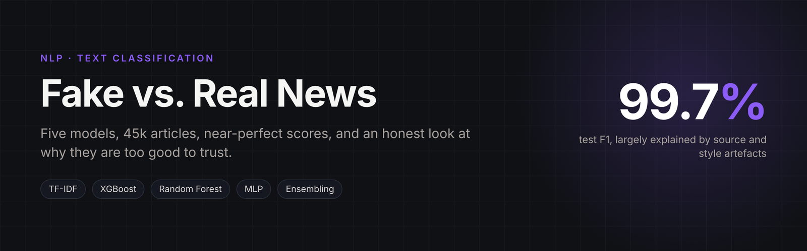
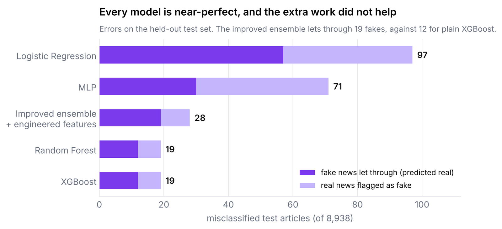
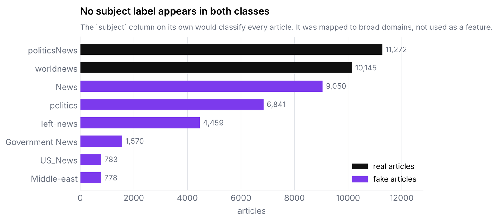
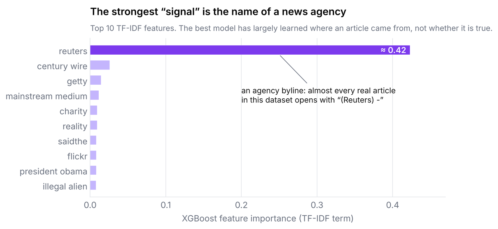
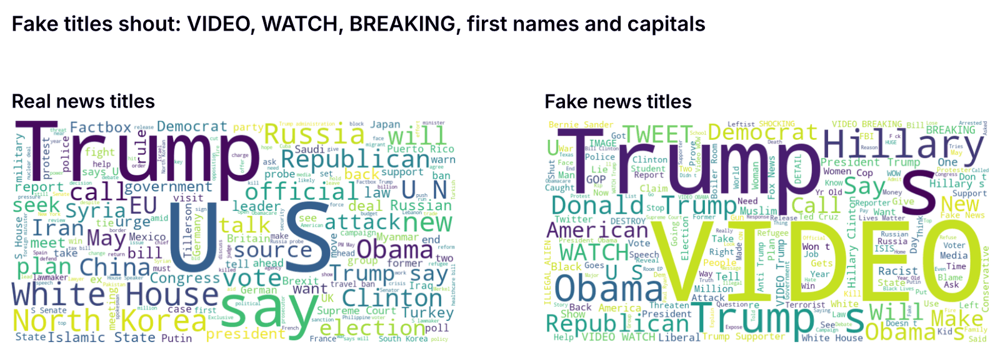

<p align="center"></p>

# Fake vs. Real News Classification

Classifying ~45k news articles as real or fake with classical NLP and gradient-boosted models,
then testing whether extra feature engineering, auxiliary data and ensembling actually help.

**Notebook:** [`fake_news_classification.ipynb`](fake_news_classification.ipynb)

## Approach

| Stage | What is done |
|---|---|
| EDA | subject distributions, word clouds, text-length analysis, data profiling |
| Cleaning | 196 duplicates dropped, subjects mapped to *News / Politics / Other* domains, lemmatisation and stop-word removal |
| Features | TF-IDF, 5,000 features, unigrams + bigrams |
| Baseline models | Logistic Regression, Random Forest, XGBoost, MLP, each evaluated overall **and per domain** |
| Improvement | train/val/test split, stylistic features (sentence count, word length, punctuation, casing), auxiliary fake headlines, zero-shot DistilBERT check, weighted XGBoost + RF ensemble |
| Validation | held-out test set and 5-fold cross-validation |

## Results

| Model | Test F1 |
|---|---|
| Logistic Regression | 0.99 |
| Random Forest | 1.00 |
| XGBoost | 1.00 |
| Ensemble + engineered features | 0.997 (CV F1 0.997) |

<p align="center"></p>

The improved pipeline made slightly *more* mistakes than the baseline (19 vs 12 fake articles
let through), which is the most useful finding: on this dataset the extra complexity did not
pay off.

## Why the scores are this high

Near-perfect scores from a TF-IDF model should raise suspicion before they raise a glass.
Three things in the notebook's own output show that the classes are separable for reasons
that have little to do with truth:

<p align="center"></p>

**Different sources, different metadata.** The two classes were scraped from different places,
and their `subject` labels do not overlap at all. The model never sees this column, but it is
a strong hint that the text carries source fingerprints too.

<p align="center"></p>

**The best feature is a byline.** XGBoost leans on the token `reuters` far more than on all
other terms combined. Real articles here are wire copy that opens with a dateline and the
agency name; fake ones carry tags such as *21st Century Wire* or *Getty* image credits.

<p align="center"></p>

**Style, not substance.** Fake titles are full of *VIDEO*, *WATCH* and *BREAKING*, first names
and capital letters; real titles read like wire headlines. A model that learns this will
detect a writing style, not a false claim.

So the numbers say more about this dataset than about fake-news detection in general, which
is why the next steps start with stripping these artefacts.

## Run it

```bash
pip install -r requirements.txt
jupyter notebook fake_news_classification.ipynb
```

The dataset is downloaded automatically with `kagglehub`
([Fake and Real News Dataset](https://www.kaggle.com/datasets/clmentbisaillon/fake-and-real-news-dataset)).

## Next steps

- Ablate each improvement to find which one hurt performance.
- Strip source artefacts (agency bylines, datelines) and re-evaluate.
- Test cross-dataset generalisation and tune with Optuna.
